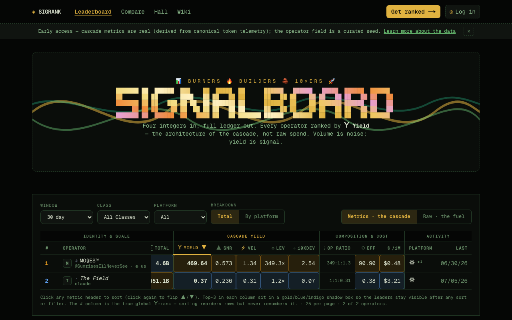
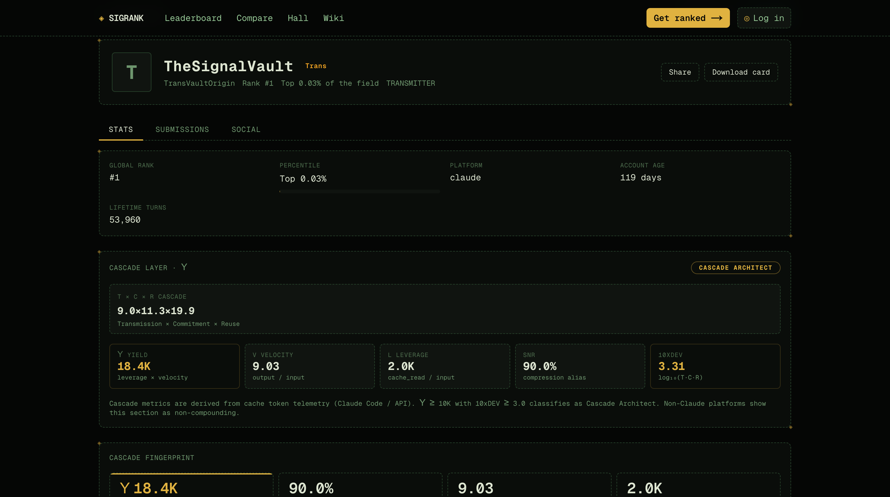

# SignalAF — Upsilon + SigRank

Rank how well you use AI, from four token counts. Run `npx sigrank` to calculate your Yield, or sign up at [signalaf.com](https://signalaf.com) to join the public board. Prompts and code never leave your machine.

[](https://github.com/SunrisesIllNeverSee/sigrank-app/actions/workflows/ci.yml)
[](https://www.npmjs.com/package/sigrank)
[](./LICENSE)

| The leaderboard | An operator profile |
| :---: | :---: |
| [](https://signalaf.com/board/all) | [](https://signalaf.com) |

This repo is the Next.js app behind [signalaf.com](https://signalaf.com): the board, profiles, wiki, accounts, billing, ingest API, MCP endpoints, and the contribution exchange.

## How it works

The server computes every score from four token counts: `input`, `output`, `cache_creation`, `cache_read`. It never receives message content.

```txt
Υ = (cache_read × output) / input²
```

- Upsilon (Υ) Yield is the rank metric. SIGNA RATE is the class credential.
- The cascade engine derives Leverage, Velocity, 10xDEV, SNR, and efficiency from the same four numbers.
- The server re-scores every submission. Client-side scores are never trusted.
- `10xDEV = log₁₀(Leverage)` and `T × C × R = Cr / I = Leverage`.
- Scoring weights (RS.xx) are server-only and stay out of this repo.

Read more in the in-app [wiki](https://signalaf.com/wiki).

## Get ranked

You do not need this repo.

```bash
npx sigrank                # see your cascade now; no install, no sign-in
npm install -g sigrank
sigrank enroll             # paste a connect code from signalaf.com > Settings
sigrank submit --dry-run   # print the signed payload; send nothing
sigrank submit             # publish verified runs to the board
```

Signing up is the only way onto the board. Operators on the original board claim an existing profile by emailing hello@signalaf.com. Challenges are muted behind `NEXT_PUBLIC_GATE_CHALLENGES` and their API routes return 404 until the gate opens.

CLI and MCP docs: [sigrank-mcp](https://github.com/SunrisesIllNeverSee/sigrank-mcp).

## Stack

- Next.js 16 App Router, React 19, TypeScript (strict)
- Tailwind CSS 3
- Supabase (Postgres, Auth, Realtime)
- Stripe Checkout, Billing Portal, webhooks
- Upstash Redis for rate limiting (Supabase Postgres fallback)
- zod, Node test runner, Vitest, Playwright

## Local setup

Requires Node 22.x (`engines` in `package.json`, `.nvmrc`).

```bash
npm install
cp .env.example .env.local   # optional; see Environment
npm run dev                  # http://localhost:3000
```

The app runs without Supabase or Stripe credentials. Without Supabase, board reads fall back to a cold-store snapshot (`lib/board/snapshot.json`), then to mock data. Billing routes return a configuration error instead of crashing.

## Scripts

| Command | What it does |
| --- | --- |
| `npm run dev` | Start the dev server |
| `npm run build` | Build for production (`next build --webpack`) |
| `npm run start` | Serve the production build |
| `npm run lint` | Run ESLint |
| `npm test` | Run the Node test suites in `__tests__/` |
| `npm run test:ui` | Run Vitest component tests |
| `npm run test:canonical` | Check canonical ingest parity (MO§ES Υ 18436.98) |
| `npm run test:coverage` | Run `npm test` with c8 coverage |
| `npm run e2e` | Run Playwright tests (`e2e:local` targets localhost:3000) |
| `npm run verify` | Run `tsc --noEmit`, the canonical test, and `npm test` |
| `npm run db:parity` | Check local migrations against the remote ledger (`db:parity:ci` for CI) |
| `npm run snapshot` | Refresh the cold-store board snapshot |
| `npm run sitemap:validate` | Validate the sitemap (`:live` checks production) |

Before opening a PR, run `npm run verify` and `npm run build`.

## Environment

Copy `.env.example` to `.env.local`. It lists every variable with notes. Never commit values. Production values live in Vercel environment variables.

| Variable | Used for |
| --- | --- |
| `NEXT_PUBLIC_SUPABASE_URL`, `NEXT_PUBLIC_SUPABASE_ANON_KEY`, `SUPABASE_SERVICE_ROLE_KEY` | Live Supabase reads and service-role writes. The server client needs all three. |
| `STRIPE_SECRET_KEY`, `NEXT_PUBLIC_STRIPE_PUBLISHABLE_KEY`, `STRIPE_WEBHOOK_SECRET`, `STRIPE_PRICE_*` | Billing and webhooks |
| `NEXT_PUBLIC_SITE_URL` | Stripe redirects and public URLs |
| `UPSTASH_REDIS_REST_URL`, `UPSTASH_REDIS_REST_TOKEN` (or Vercel's `KV_REST_API_URL`, `KV_REST_API_TOKEN`) | Shared rate limiter. Without Upstash, the limiter uses Supabase Postgres (`api_rate_limit_hit`, migration 0055), then a per-instance in-memory counter. Sensitive write routes fail closed. |
| `SIGRANK_RULESET` | Server-only RS.xx scoring overrides |
| `SIGRANK_API_KEY` | Trusted bulk-read key for the public API (`x-api-key`) |
| `SIGRANK_INGEST_WRITE` | `1` persists verified snapshots to the board. Do not mark it sensitive in Vercel; `vercel env pull` then returns an empty value. |
| `CRON_SECRET` | Bearer token for `/api/cron/recompute` |
| `NEXT_PUBLIC_POSTHOG_KEY`, `NEXT_PUBLIC_POSTHOG_HOST`, `POSTHOG_KEY` | Product analytics |
| `RESEND_API_KEY`, `*AGENTMAIL_API_KEY` | Contact form and exchange email |
| `ALGOLIA_*`, `EXA_API_KEY`, `MOTHERDUCK_*`, `AI_GATEWAY_*`, `VERCEL_CLIENT_*`, `SIGNALAF_LIVE_TOKEN` | Search, enrichment, analytics, AI gateway, Vercel integration, live demo |
| `NEXT_PUBLIC_REALTIME_ENABLED` | Set to `false` to disable live board updates |

### Feature flags

`lib/features.ts` defines the flags. All gated flags default to off and accept `1` or `true`.

| Flag | Gates |
| --- | --- |
| `NEXT_PUBLIC_GATE_CHALLENGES` | Throw-down challenges. Also needs `NEXT_PUBLIC_GATE_ARENA`. Off: `/api/v1/challenges` returns 404. |
| `NEXT_PUBLIC_GATE_ARENA` | Challenge submission interface (required with the challenges gate) |
| `NEXT_PUBLIC_GATE_SIGNAL_DROP` | Weekly signal drop |
| `NEXT_PUBLIC_GATE_BRACKETS` | Blind bracket / Circle Wars |
| `NEXT_PUBLIC_GATE_TRADING_CARD_SPECIES` | Species badge on trading cards |

## Database and migrations

Migrations live in [`supabase/migrations/`](./supabase/migrations/): 57 files, latest `0055_api_rate_limits`. Apply new migrations to production before you deploy code that depends on them. Migrations 0053 to 0055 (operator security boundaries, security hardening pass 2, API rate limits) back the current security code. Run `npm run db:parity` to compare local files with the remote ledger.

Row Level Security policies, seed data, and security tests live in [`supabase/`](./supabase/). See [`supabase/README.md`](./supabase/README.md) to run your own instance.

## Project map

| Path | Contents |
| --- | --- |
| `app/` | App Router pages and API routes |
| `app/api/v1/` | Public API: ingest, claim, devices, billing, metrics, leaderboard |
| `app/api/mcp/`, `app/api/plugins/sigrank/mcp/`, `app/api/exchange/mcp/` | MCP endpoints (main server, analyst plugin, exchange) |
| `app/exchange/`, `app/api/exchange/` | Contribution exchange UI and API |
| `components/` | UI components |
| `lib/board/` | Board reads: Supabase, snapshot, mock fallback |
| `lib/ingest/` | Payload parsing, signature checks, cascade materialization |
| `lib/analytics/` | Scoring engine and server-only ruleset boundary |
| `lib/exchange/`, `lib/exchange-gateway/` | Exchange server logic and portable gateway reference |
| `lib/infra/` | Supabase clients, Stripe, rate limiting, API gates |
| `supabase/` | Migrations, policies, seeds, SQL tests, edge functions |
| `__tests__/`, `e2e/` | Node, Vitest, and Playwright tests |

Development conventions:

- Pages are server components by default. Add `'use client'` only for hooks, handlers, or browser APIs.
- Keep RS.xx scoring configuration out of client code.
- Avoid random values and wall-clock reads at module scope.

## Deployment

Pushes to `main` deploy to Vercel (`vercel.json`). A daily cron calls `/api/cron/recompute`. Set environment variables in Vercel. An OpenNext Cloudflare path exists (`npm run preview`, `npm run deploy`, `wrangler.jsonc`).

## Security

Report vulnerabilities privately. Email the maintainer or open a private GitHub security advisory. Do not file public issues for vulnerabilities. See [`SECURITY.md`](./SECURITY.md).

## Related

- [sigrank-mcp](https://github.com/SunrisesIllNeverSee/sigrank-mcp): the `npx sigrank` CLI, TUI, and MCP server
- [signalaf.com/score](https://signalaf.com/score): paste four token counts, get a projected yield
- [MO§ES](https://mos2es.com): the governance framework behind Upsilon

## Contributing

Open an [issue](https://github.com/SunrisesIllNeverSee/sigrank-app/issues) with repro steps and your Node version. For code changes, branch from `main`, keep the change small, run `npm run verify`, and open a PR. See [Contributing](./.github/CONTRIBUTING.md) and the [Code of Conduct](./.github/CODE_OF_CONDUCT.md).

## License

MIT. See [`LICENSE`](./LICENSE).
